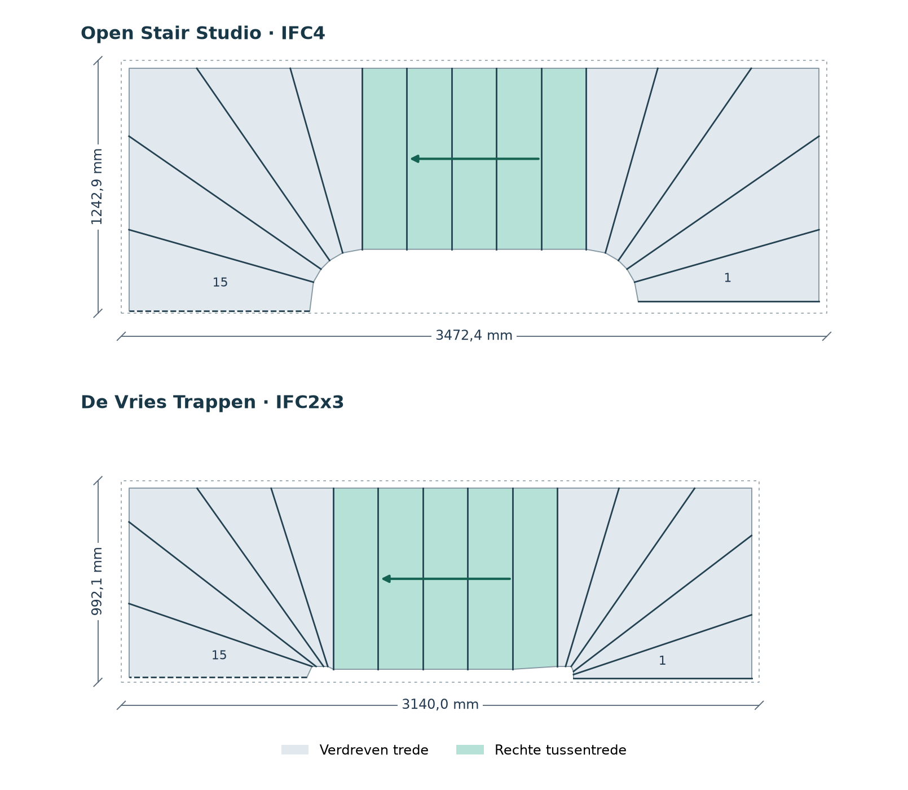
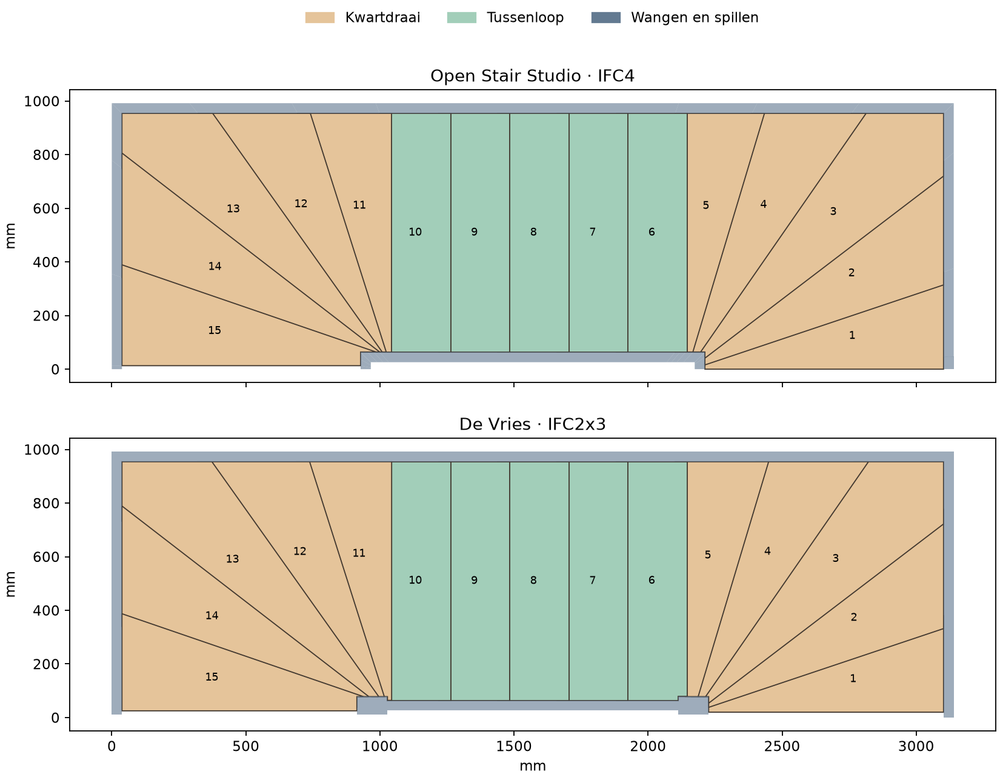

# BIM-vergelijking met gepubliceerde IFC-trappen

Op 27 november 2026 zijn tien openbare IFC-bestanden met veertien trappen doorgemeten. Alle 241 onderdelen met een eigen geometrische representatie binnen deze trappen konden als driehoeksnet worden opgebouwd. De vergelijking onderzoekt welke maten, objecten en relaties een ontvangende BIM-toepassing uit het bestand kan halen.

## Houten trappen van De Vries Trappen

De leverancier publiceert de trapgatmaten bij de downloads. De kolom met modelmaten hieronder geeft de omhullende doos van álle gemodelleerde traponderdelen, inclusief uitstekende bomen of spillen, langs de wereldassen. Optrede en aantrede komen uit de eigenschappenset `CS_Set_Dimensions`. De controle gebruikte telkens het bestand met suffix `-L.IFC` uit de ZIP. [Downloadcatalogus De Vries Trappen](https://www.devriestrappen.nl/downloads/)

| Trap en fabrikantbestand | Trapgat volgens catalogus (mm) | Onderdelen | Modelmaat X × Y × Z (mm) | Optrede / aantrede (mm) | SHA-256 van IFC, eerste 12 |
| --- | --- | ---: | --- | --- | --- |
| [Steek, open](https://www.devriestrappen.nl/friksbeheer/wp-content/uploads/2019/09/Steektrap-open-3300x900-IFC.zip) | 3300 × 900 | 19 | 3378 × 880 × 3000 | 187,5 / 220 | `6d4f16d9ed7b` |
| [Steek, dicht](https://www.devriestrappen.nl/friksbeheer/wp-content/uploads/2019/09/Steektrap-dicht-3300x900-IFC.zip) | 3300 × 900 | 34 | 3378 × 880 × 3000 | 187,5 / 220 | `4a01f111d71a` |
| [Bovenkwart, dicht](https://www.devriestrappen.nl/friksbeheer/wp-content/uploads/2019/09/Bovenkwart-Dicht-2100x2100x1000x1000-IFC.zip) | 2100 × 2100 × 1000 × 1000 | 37 | 2171,1 × 2080 × 3000 | 187,5 / 220 | `6522649f1d23` |
| [Onderkwart, dicht](https://www.devriestrappen.nl/friksbeheer/wp-content/uploads/2019/09/Onderkwart-Dicht-2200x2000x1000x1000-IFC.zip) | 2200 × 2000 × 1000 × 1000 | 37 | 2180 × 2071,2 × 3087,3 | 187,5 / 220 | `78b53bc49982` |
| [Spil, dicht](https://www.devriestrappen.nl/friksbeheer/wp-content/uploads/2019/09/Spiltrap-Dicht-1850x1910-IFC.zip) | 1850 × 1910 | 38 | 1894 × 1830 × 3297,2 | 181,25 / 220 | `5e23e571ca12` |
| [Tweekwart, open](https://www.devriestrappen.nl/friksbeheer/wp-content/uploads/2019/09/Tweekwart-Open-3160x1000-IFC.zip) | 3160 × 1000 | 23 | 3140 × 984,4 × 3950 | 181,25 / 220 | `cc2f4875b230` |
| [Tweekwart, dicht](https://www.devriestrappen.nl/friksbeheer/wp-content/uploads/2019/09/Tweekwart-Dicht-3160x1000-IFC.zip) | 3160 × 1000 | 38 | 3140 × 992,1 × 3950 | 181,25 / 220,513 | `71baad364be8` |

Deze zeven Compass-modellen zijn geschreven als IFC2X3. Elke trap heeft één `IfcStair` met via `IfcRelAggregates` rechtstreeks gekoppelde `IfcBuildingElementPart`-onderdelen. Elk van de 226 delen heeft een eigen BRep. De leverancier gebruikt voor een boven- of onderkwart `QUARTER_WINDING_STAIR` en voor zowel de tweekwart als deze specifieke spiltrap `TWO_QUARTER_WINDING_STAIR`. De bouwlaag aggregeert de trap. Er zijn geen afzonderlijke `IfcStairFlight`-objecten, materiaalobjecten, hoeveelhedensets of classificatierelaties in deze bestanden. De vijf draaiende modellen hebben wel materiaalnamen per onderdeelgroep als tekst in `CS_Set_Materials`. [BIM bij De Vries Trappen](https://www.devriestrappen.nl/seriematige-trappen/bim/)

### Aansluiting van de gesloten steektrap

Het gesloten model bevat vijftien volle tredebladen van 265 × 804 × 38 mm, een bovenste aansluitstuk van 58 × 804 × 38 mm, zestien stootborden van 13 mm dik en twee bomen van 38 mm dik. Het open model bevat alleen het bovenste stootbord bij de vloeraansluiting. De optrede van 187,5 mm geeft zestien optredes over 3000 mm.

Bij de eerste trede ligt de voorkant op wereld-X 3358 mm en het zichtvlak van het onderliggende stootbord op 3313 mm. Bij de tweede liggen die vlakken op 3138 en 3093 mm. **De gemeten wel is beide keren 45 mm** en de afstand van neus tot neus is 220 mm. De bovenzijde van het eerste stootbord en de onderzijde van de eerste trede liggen op dezelfde Z van −2850,5 mm. Het volgende stootbord ligt met zijn zichtvlak op X 3093 mm tegen de achterkant van de eerste trede. De modellen geven hiermee een referentie voor positie en contactvlakken. Freesdiepte en passingstolerantie zijn in deze IFC niet gespecificeerd. [IFC gesloten steektrap](https://www.devriestrappen.nl/friksbeheer/wp-content/uploads/2019/09/Steektrap-dicht-3300x900-IFC.zip)

## Eerdere vergelijking met de steektrap, kwartslag en doorlopende halfslag

Het [vergelijkingsproject](../examples/bim-steektrap-vergelijking.oss.json) is via `readProject` ingelezen en via dezelfde geometrie- en IFC4-functies als in de toepassing geëxporteerd. Voor de drie onderstaande paren zijn de zes IFC-bestanden opnieuw geopend en getrianguleerd. De eigen bestanden bevatten elk één `IfcStair` met één `IfcStairFlight`, vijftien tredebladen en zestien stootborden. Alle 123 eigen onderdelen met geometrie konden worden gemeten.

**Invoer.** Alle drie eigen modellen hebben zestien optredes, gesloten stootborden met stuikverbinding en automatische positie, tredepositie 45 mm, bladdikte 38 mm, borddikte 13 mm, wangdikte 38 mm en geen leuningen. De eigen steektrap heeft een breedte van 880 mm. De twee draaiende modellen gebruiken 966 mm, gebaseerd op de lokaal gemeten rechte bladbreedte van 890 mm bij de fabrikant plus twee wangen van 38 mm. Voor de kwartslag is 3000 mm vloerhoogte en 220 mm aantrede gebruikt, voor de halfslag 2900 en 220,513 mm. Beide hebben vijf boogtreden per kwart, een haakse buitenwang en draaien linksom. De kwartslag begint met vijf treden vóór de boog, de halfslag met twee.

| Vorm | Onderdelen met geometrie, Studio / De Vries | Modelmaat X × Y × Z van Studio (mm) | Modelmaat X × Y × Z van De Vries (mm) | Verandering van richting > 1° bij Studio / De Vries |
| --- | --- | --- | --- | --- |
| Steek, dicht | 33 / 34 | 3313 × 880 × 3000 | 3378 × 880 × 3000 | 0 / 0 van 15 intervallen |
| Kwart met verdreven treden / bovenkwart | 42 / 37 | 2328,3 × 2238,3 × 3000 | 2171,1 × 2080 × 3000 | 9 / 5 van 15 intervallen |
| Halve draai / tweekwart | 48 / 38 | 1801,5 × 2369,8 × 2900 | 3140 × 992,1 × 3950 | 14 / 10 van 15 intervallen |

**Trede en stootbord.** Bij alle 45 vergeleken tredebladen (vijftien per vorm) is de wel loodrecht op het zichtvlak van het bijbehorende stootbord gemeten. Die afstand is bij De Vries 45,00 mm en bij deze eigen stuikverbinding 0,00 mm. Het invoerveld *Tredepositie langs looplijn* schuift in Studio het hele blad en het bijbehorende stootbord. Het verschil is ook terug te vinden in de rechte bladen van de steektrap. Die meten in Studio 220 × 804 × 38 mm en bij de fabrikant 265 × 804 × 38 mm. De gemeten aantrede van 220 mm, de optrede van 187,5 mm en het contact met de onderkant van de trede komen overeen. Studio heeft hier vijftien volle tredebladen en twee bomen. Bij De Vries is een zestiende, smal aansluitblad op de verdiepingsvloer gemodelleerd.

**Verdrijving.** De richting van de langste bovenrand van ieder stootbord is uit de IFC-mesh gemeten. De borden zijn op hoogte gesorteerd en hun onderlinge hoek is per trede bepaald. Een verschil groter dan 1° telt in deze vergelijking als draaiend interval. De totale draai is in beide kwartslagmodellen 90° en in beide halve draaien 180°. Bij het bovenkwart van De Vries gebeurt de draai in vijf opeenvolgende intervallen. In Studio gaat de richting over meer treden geleidelijk over. In de tweekwart van De Vries liggen vijf rechte intervallen tussen twee afzonderlijke verdreven kwarten. De eigen halfslag beschrijft één doorlopende boog. De lange en korte zijden van de omhulling en de verdeling van de boomsegmenten laten hetzelfde vormverschil zien.

**Aansluiting op de vloer, vóór en na correctie.** In de eerste eigen IFC-uitvoer staken de twee onderste wangsegmenten (`ST-01-WG-L1` en `ST-01-WG-R1`) bij de kwartslag 92,5 mm en bij de halfslag 98,75 mm onder de startvloer uit. Bij de fabrikant eindigen beide bomen op de startvloer. Na correctie van de zaagsnede in het trapmodel zijn de eigen kwart- en halfslag linksom én rechtsom opnieuw geëxporteerd. De acht onderzochte wangvoeten eindigen nu op Z = 0,00 mm. De tabel toont de nagemeten eindmaten. De hogere Z-maat van de tweekwart bij De Vries is terug te voeren op een spil die 1050 mm boven de verdiepingsvloer uitkomt.

**Linksom en rechtsom.** Na spiegelen over het XZ-vlak zijn alle unieke meshpunten uit de eigen IFC-bestanden vergeleken op een afronding van 0,0001 mm. Bij de kwartslag kwamen alle 254 punten overeen en bij de halfslag alle 290. De fabrikantvergelijking gebruikt de beschikbare linker modellen.

## Onafhankelijke wel en tweekwart met automatisch berekende buitenmaten

Bij de gesloten tweekwart van De Vries zijn de zestien stootborden op hoogte gesorteerd. Hun voorvlakken draaien achtereenvolgens 18,53°, 18,81°, 17,92°, 18,04° en 16,70°, blijven vijf intervallen evenwijdig en draaien vervolgens 17,64°, 17,75°, 16,95°, 18,73° en 18,94°. Elk kwart draait in totaal 90°. Alle vijftien volle treden hebben 45,00 mm wel en de vijf rechte bladen meten tussen hun lange evenwijdige zijden 265,512 tot 265,513 mm. Bij de rechte referentietrap zijn die bladen 265,00 mm diep. [Gesloten tweekwart van De Vries](https://www.devriestrappen.nl/friksbeheer/wp-content/uploads/2019/09/Tweekwart-Dicht-3160x1000-IFC.zip) · [Gesloten steektrap van De Vries](https://www.devriestrappen.nl/friksbeheer/wp-content/uploads/2019/09/Steektrap-dicht-3300x900-IFC.zip)

De meetproef gebruikt de begrenzing van het hoogste horizontale vlak van elk blad en stootbord. De IFC4-mesh wordt opgebouwd met IfcOpenShell. Voor IFCX leest de proef de geëxporteerde driehoeken rechtstreeks uit. Gedeelde driehoeksranden vervallen vóór het bepalen van de bordrichting en de projectie van de neus op de plaatselijke normaal. De hoek tussen twee opeenvolgende borden meet de verdeling van de draai. De omhulling omvat ook de bomen en eventuele spillen. [Meetscript](../scripts/measure-wel-tweekwart.py)

| Meting bij tredepositie 0 mm | Studio, gesloten steek | De Vries, gesloten steek | Studio, gesloten tweekwart links / rechts | De Vries, gesloten tweekwart links |
| --- | ---: | ---: | ---: | ---: |
| Producten met eigen geometrie | 33 | 34 | 48 / 48 | 38 |
| Lange × korte zijde van de omhulling (mm) | 3358 × 880 | 3378 × 880 | 3472,394 × 1242,915 | 3140 × 992,105 |
| Hoogte van de omhulling (mm) | 3000 | 3000 | 2900 | 3950 |
| Draaiende / rechte / draaiende intervallen | 0 / 15 / 0 | 0 / 15 / 0 | 5 / 5 / 5 | 5 / 5 / 5 |
| Wel op alle 15 bladen (mm) | 45 | 45 | 45 | 45 |



Beide plattegronden staan op dezelfde schaal. De trap begint rechtsonder bij trede 1, draait linksom en eindigt linksonder bij trede 15. De donkere lijnen volgen de vijftien gemeten tredevoorranden. De korte streeplijn bij de uitgang markeert het zichtvlak van het zestiende stootbord. De lichte zijcontour verbindt de meetpunten en de maatlijnen horen bij de omhulling van alle gemodelleerde onderdelen. [Figuur uit IFC genereren](../scripts/plot-two-quarter.py) · [IFC van De Vries](https://www.devriestrappen.nl/friksbeheer/wp-content/uploads/2019/09/Tweekwart-Dicht-3160x1000-IFC.zip)

De drie tredeposities verschuiven het middelpunt van het eerste stootbord van de eigen steektrap langs X naar respectievelijk 66,5, 51,5 en 36,5 mm. De wel blijft bij alle 270 metingen aan de negen IFC4/IFCX-paren 45,00 mm. De rechte steektrapbladen meten 265 mm. De eigenschap `NosingLength` op zowel de trap als de vlucht geeft in beide uitwisselformaten 0,045 m.

Het eigen ontwerp verdeelt elk kwart over 15,86°, 18,82°, 20,65°, 18,82° en 15,86°. Rechte aantrede en bladdiepte in het midden zijn bij beide ontwerpen circa 220,513 en 265,513 mm. De eigen omhulling bij positie nul is aan de lange kant 332,394 mm en aan de korte kant 250,810 mm groter. De spil van de fabrikant steekt 1050 mm boven de verdieping uit. De vijf rechte tussenintervallen en de wel komen overeen, maar het eigen ontwerp vraagt een andere plattegrond.

De fabrikant-ZIP's voor de gesloten steektrap en tweekwart bevatten elk één IFC met suffix `-L.IFC`. Voor de eigen tweekwart zijn links en rechts apart geëxporteerd en over het XZ-vlak vergeleken. Alle unieke meshpunten kwamen bij elk van de drie posities in zowel IFC4 als IFCX na spiegeling overeen op 0,01 mm afronding. De twee ontwerpen op positie nul zijn beschikbaar als bewerkbaar project, IFC4 en IFCX. [Vergelijkingsbundel links en rechts](../examples/bim-tweekwart-vergelijking.zip)

De exportproef gebruikt zestien optredes, een wel van 45 mm en tredeposities −15, 0 en +15 mm. De tweekwart gebruikt vijf treden per kwart, vijf recht ertussen, nul vóór de eerste boog, een breedte van 966 mm, een vloerhoogte van 2900 mm en een aantrede van 220,513 mm. Met de volgende opdrachten zijn de negen modelparen opnieuw te maken en te meten. Vervang de fabrikantpaden door de uitgepakte bestanden uit de twee ZIP-archieven.

```powershell
node scripts/export-wel-tweekwart.mjs "$env:TEMP/oss-wel-vergelijking"
uv run --no-project --python 3.12 --with ifcopenshell==0.9.0.post1 python scripts/measure-wel-tweekwart.py --verify-exports "$env:TEMP/oss-wel-vergelijking" "C:\BIM\Steektrap_Dicht (3300x900)-L.IFC" "C:\BIM\Boven_- onderkwart_Dicht (3160x1000)-L.IFC"
```

## Maatvaste gesloten tweekwart

De referentie meet in wereldcoördinaten van X = 10 tot 3150 mm en Y = 7,895 tot 1000 mm. De twee spillen hebben elk een doorsnede van 114 × 66 mm. De onderste staat op X = 2122–2236 mm en de bovenste op X = 924–1038 mm, beide op Y = 20–86 mm. De binnenwang van de tussenloop loopt van X = 1038 tot 2122 mm en van Y = 34 tot 72 mm. De buitenwang ligt op Y = 962–1000 mm. De fabrikant levert de linkse uitvoering. [Gesloten tweekwart van De Vries](https://www.devriestrappen.nl/friksbeheer/wp-content/uploads/2019/09/Tweekwart-Dicht-3160x1000-IFC.zip)

| Meting aan de geëxporteerde onderdelen | Studio, links en rechts, IFC4 en IFCX | De Vries, links, IFC2x3 |
| --- | ---: | ---: |
| Buitenmaat inclusief wangen, lang × diep | 3140,000 × 992,000 mm | 3140,000 × 992,105 mm |
| Hoogte inclusief alle onderdelen | 2900 mm | 3950 mm |
| Wel op elk van de vijftien volle treden | 45,000 mm | 45,000 mm |
| Vijf rechte aantreden | 220,513 mm | 220,512–220,513 mm |
| Bladdiepte van de vijf rechte treden | 265,513 mm | 265,512–265,513 mm |
| Onderkwart, hoekstappen in graden | 18,533 / 18,809 / 17,920 / 18,040 / 16,698 | 18,533 / 18,809 / 17,920 / 18,040 / 16,698 |
| Bovenkwart, hoekstappen in graden | 17,639 / 17,746 / 16,945 / 18,731 / 18,939 | 17,639 / 17,746 / 16,945 / 18,731 / 18,938 |
| Zichtvlak stootbord 7 vanaf de linker buitenkant in de figuur | 1880,7355 mm | 1880,7350 mm |



De figuur lijnt de eerste stijgrichting en de buitenste hoek van de omhulling uit. Met een verschuiving van +20,034 mm langs de tussenloop valt het zevende stootbord op 0,0005 mm van het referentievlak. Het bronmodel heeft twee afzonderlijke spillen, aansluitende sparingen in de bladen en een vloerlijst. De bovenste spil steekt 1050 mm boven de verdieping uit. Studio modelleert de aansluiting met gesegmenteerde wangen. [Projecten en BIM-exports voor links en rechts](../examples/tweekwart-3140x992.zip)

Voor de vergelijking van de bladcontouren meet de proef voor elk hoekpunt de afstand tot de andere bladrand, in beide richtingen. Onderstaande getallen geven per trede de grootste gemeten afstand in de uitgelijnde plattegrond.

| Groep | Treden in stijgrichting | Grootste contourafstand per blad (mm) |
| --- | --- | --- |
| Onderkwart | 1–5 | 24,41 · 26,30 · 23,32 · 24,26 · 15,54 |
| Rechte tussenloop | 6–10 | 14,11 · 0,11 · 0,11 · 0,11 · 14,11 |
| Bovenkwart | 11–15 | 14,11 · 15,81 · 19,04 · 42,71 · 48,89 |

De maatproef leest vijf instellingen terug, elk in beide draairichtingen en beide bestandsformaten. In de variant van 3300 × 1100 mm krijgt het bovenkwart de hoeken 15°, 17°, 19°, 20° en 19°. In de tweede hoekvariant op 3140 × 992 mm veranderen alleen de hoeken van het onderkwart in 17°, 18°, 19°, 20° en 16°. Bij de tredeposities −15, 0 en +15 mm ligt het midden van het eerste stootbord op respectievelijk X = 66,5, 51,5 en 36,5 mm in de Studio-export. Alle drie behouden de buitenmaat van 3140 × 992 mm. Alle 300 welmetingen aan de twintig bestanden geven 45,000 mm. [Meetscript](../scripts/measure-compact-tweekwart.py)

De linkse en rechtse referentie-export bevatten elk 15 bladen, 16 stootborden en 30 wangdelen. De spiegelproef vergelijkt de 3D-hoekpunten, het oppervlak en het volume per onderdeel. Voor alle vijf instellingen kwamen de hoekpunten na spiegeling binnen 0,000001 mm overeen in elk formaat. Tussen IFC4 en IFCX bedroeg het grootste hoekpuntverschil minder dan 0,000033 mm. IfcOpenShell 0.9.0.post1 valideerde de tien IFC4-bestanden inclusief EXPRESS-regels zonder meldingen. [Validatie en meettoleranties](../scripts/measure-compact-tweekwart.py)

Gebruik voor de fabrikantvergelijking het uitgepakte IFC-bestand uit de gelinkte ZIP. Zonder `--reference` en `--figure` controleert dezelfde opdracht alle twintig eigen exports.

```powershell
node scripts/export-compact-tweekwart.mjs "$env:TEMP/oss-compact-tweekwart" --varianten
uv run --no-project --python 3.12 --with ifcopenshell==0.9.0.post1 --with pytest --with matplotlib python scripts/measure-compact-tweekwart.py "$env:TEMP/oss-compact-tweekwart" --express --reference "C:\BIM\Boven_- onderkwart_Dicht (3160x1000)-L.IFC" --figure docs/vergelijking-tweekwart-maatvast.png
```

## Onafhankelijke gebouwmodellen

| Bron | Trappen in het bestand | Gemeten geometrie en opbouw |
| --- | --- | --- |
| [Duplex Apartment, buildingSMART Community, gepinde revisie](https://github.com/buildingsmart-community/Community-Sample-Test-Files/blob/7ddf57a201f88a0c213d5322b02ed15e94a60a40/IFC%202.3.0.1%20%28IFC%202x3%29/Duplex%20Apartment/Duplex_A_20110907.ifc) | Twee rechte IFC2X3-trappen op Level 1 | Per trap één `IfcStairFlight`, twee `IfcMember` en twee `IfcRailing`. De vlucht bevat een looplijn, een begrenzing en een `SweptSolid`-body van 914,4 × 3772,4 × 3050 mm. SHA-256 begint met `b347a2c8aa8f`. |
| [KIT, FZK-Haus](https://www.ifcwiki.org/images/e/e3/AC20-FZK-Haus.ifc) | Eén IFC4-wenteltrap op Erdgeschoss | Eén `IfcStair` met eigen BRep en Box, 1596,4 × 1708,9 × 3560 mm. Het object heeft `Pset_StairCommon`. SHA-256 begint met `70cc8ff245fc`. |
| [KIT, kantoorgebouw](https://www.ifcwiki.org/images/9/98/AC20-Institute-Var-2.ifc) | Vier IFC4-trappen op vier verschillende bouwlagen | Vier afzonderlijke `IfcStair`-objecten gebruiken een `MappedRepresentation` en een Box. De geometrie per trap meet 5400 × 4000 × 4194,3 mm. SHA-256 begint met `cfb2124497b2`. |

De twee KIT-modellen komen van het Institute for Automation and Applied Informatics (IAI), Karlsruhe Institute of Technology, en zijn geëxporteerd uit Archicad 20. Hun trappen zijn indeelbaar per bouwlaag, maar hebben geen selecteerbare onderliggende vluchten. [Publicatie en gebruiksvoorwaarden van KIT](https://www.ifcwiki.org/index.php?title=KIT_IFC_Examples)

Het Duplex-bestand laat zien waarom een uitleestest ook de vorm moet nameten. De projecteenheid is meter. Bij beide vluchten geven de directe IFC-attributen na eenheidsconversie 635,66 mm optrede en 820,21 mm aantrede. `Pset_StairFlightCommon` geeft 193,75 en 250 mm. Aan de eerste twee opeenvolgende bovenvlakken zijn 193,75 mm verticale en 250 mm horizontale afstand gemeten. De twee telattributen komen wel overeen met zestien optredes en vijftien loopvlakken. [Duplex Apartment, IFC-download](https://media.githubusercontent.com/media/buildingsmart-community/Community-Sample-Test-Files/7ddf57a201f88a0c213d5322b02ed15e94a60a40/IFC%202.3.0.1%20%28IFC%202x3%29/Duplex%20Apartment/Duplex_A_20110907.ifc)

## Zelf nameten

Bij het inlezen als gebouwmodel telt Studio de werkelijk aan vloeren gekoppelde sparingen. Het KIT FZK-Haus bevat vier IFC-vloerplaten en zeventien openingen in het hele gebouw. Eén opening hoort bij een vloerplaat. In het Institute-model gaat het om 26 vloerplaten en vier vloersparingen uit 287 gebouwopeningen. De aantallen zijn zowel via IfcOpenShell als via de BIM-werkruimte gecontroleerd. [Gebouwmodellen van KIT](https://www.ifcwiki.org/index.php?title=KIT_IFC_Examples)

Het [meetblad met doorsneden](../output/pdf/BIM-vergelijking-trappen.pdf) toont op gelijke schaal hoe het verschil in wel terugkomt in de treden en stootborden.

**Ontvangst in Bonsai.** In Blender 4.5.10 LTS opende Bonsai het meegeleverde IFC4-bestand via de normale projectimport. Alle 33 fysieke onderdelen kregen een eigen Blender-mesh, samen 404 vlakken. De ontvangen vlucht ST-01-V1 bevatte zestien optredes en vijftien treden met een optrede van 0,1875 m en een aantrede van 0,220 m. Deze ontvangerproef geldt voor IFC4.

Bij 51 proefposities in vloermateriaal en zeven in sparingen in de drie gebouwmodellen kwam de doorsnedetoets overeen met de verwachte uitkomst. De aanvullende regressie bevat onder meer een inspringing van 3 mm, een vloereiland onder een trede, een raaklijn en een onvolledige contour. [Proeven met vloerdoorsneden](../scripts/verify-host-section-fit.mjs)

**Plaatsing in het FZK-Haus.** In vloer Slab-033 (#59290) loopt sparing #59365 van Z = 2500 tot 2700 mm. De vier ingelezen hoekpunten wijken maximaal 0,00012 mm af van een afzonderlijke IfcOpenShell-meting. Bij de eigen steektrap met verdiepingshoogte 2700 mm, breedte 880 mm, zestien optredes en aantrede 220 mm is het snijpeil 2600 mm. Met projectnulpunt (6390,185 / 2100 / 0) mm en rotatie 0° past de doorsnede in de sparing. Met X = 2190,185 mm meldt Studio een doorsnijding met Slab-033. De conclusie betreft de horizontale doorsnede op het getoetste peil.

Het vergelijkingsmodel van de gesloten steektrap is meegeleverd als [bewerkbaar project](../examples/bim-steektrap-vergelijking.oss.json), [IFC4](../examples/ST-01-coordinatiemodel.ifc) en [IFCX alpha](../examples/ST-01-coordinatiemodel.ifcx). De bestanden zijn vanuit de BIM-werkruimte gedownload. Voor alle 33 fysieke onderdelen zijn de identiteit, de omhulling in wereldcoördinaten en het opgegeven nettovolume uit beide bestanden gecontroleerd tegen de geometrie in IfcOpenShell.

De onafhankelijke uitwisseltest vergelijkt daarnaast acht eigen IFC4/IFCX-modelparen, waaronder een kwartbordes, verdreven trappen en een opstelling met glas, staal, een boomloze trap en een vluchttrap. Ze vergelijkt de begrenzing en het volume per fysiek onderdeel. Dezelfde IFC4-modellen leveren de maatstaf voor de IFCX-conversie. De fabrikantbestanden hierboven leveren een afzonderlijke vergelijking van de ontwerpen. [Uitwisseltest](../scripts/verify-ifcx-independent.py) · [Test van de BIM-knoppen en downloads](../scripts/verify-bim-downloads.py)

Pak het IFC-bestand uit de gewenste fabrikant-ZIP uit, of download een van de gebouwmodellen. Voer vanuit de projectmap de onafhankelijke meting uit met Python 3.12 en IfcOpenShell 0.9.0.post1. Er mogen meerdere bestandspaden achter het commando staan.

```powershell
uv run --no-project --python 3.12 --with ifcopenshell==0.9.0.post1 python scripts/inspect-reference-ifc.py --details "C:\BIM\Duplex_A_20110907.ifc"
```

De JSON-uitvoer vermeldt de volledige SHA-256 van de uitgepakte IFC, de projecteenheid, de objecttypen, de eigenschappen en de aanwezige ruimtelijke relaties. De meting volgt de decompositie van iedere trap en bouwt alle objecten met een representatie op in wereldcoördinaten. Elk object telt één keer per trap. Fouten bij het trianguleren worden gerapporteerd en leveren een foutcode op. Met `--details` bevat het resultaat per product de STEP-id, de uiterste coördinaten en de contourranden op het hoogste vlak. Voor vluchten worden ook de hoogtes en begrenzingen van de horizontale driehoeken gegeven.

Voor de welmeting zijn de parallelle bovenranden van blad en stootbord langer dan 500 mm op de plaatselijke normaal geprojecteerd. Het verschil tussen de voorste projecties is de wel. Voor de draai zijn de gerapporteerde hoeken van de langste bovenranden van de zestien stootborden per opeenvolgend paar vergeleken, rekening houdend met het doorlopen van 180°. Zo zijn ook de metingen bij schuine tredekoppen te reproduceren.

De openbare modellen zijn bedoeld voor vergelijking van BIM-uitwisseling. Projectgebonden ILS-afspraken, constructieve toetsing en CNC-vrijgave hebben elk eigen acceptatiecriteria.
