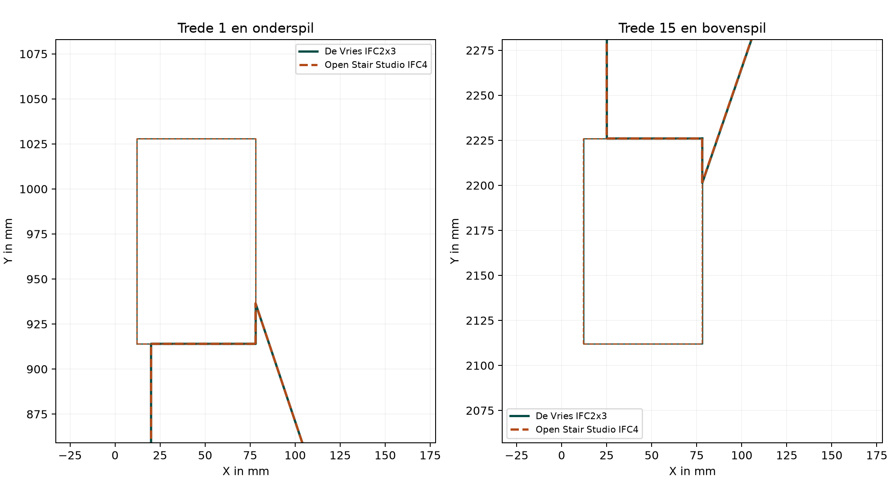

# Spillen en tredecontouren van de dichte tweekwart

De fabrikantreferentie voor trapgat 3160 × 1000 mm heeft twee rechthoekige spillen van 114 × 66 mm. De onderspil raakt de treden 1 tot en met 6. De bovenspil raakt de treden 10 tot en met 15 en steekt 1050 mm boven de verdiepingsvloer uit. De Vries tekent beide spillen als massieve balken en geeft de aansluitende bladen een uitsparing. De gemeten bladen en balken raken elkaar over een lijn in plattegrond. De twee IFC-bestanden in het fabrikantarchief hebben dezelfde SHA-256. Voor de rechtertrap is daarom de gespiegelde linker referentie gebruikt. [Download fabrikantmodel](https://www.devriestrappen.nl/friksbeheer/wp-content/uploads/2019/09/Tweekwart-Dicht-3160x1000-IFC.zip)

## Metingen aan het fabrikantmodel

Het assenstelsel hieronder heeft de oorsprong bij de buitenste hoek naast de eerste trede. X loopt langs de eerste stijgrichting en Y langs de rechte tussenloop. De omzetting uit wereldmillimeters van het fabrikantmodel is X = wereld-Y − 7,895 en Y = 3150 − wereld-X. Z = 0 ligt op de vertrekvloer.

| Onderdeel | X-bereik (mm) | Y-bereik (mm) | Z-bereik (mm) |
| --- | ---: | ---: | ---: |
| Onderspil | 12,105–78,105 | 914–1028 | 0–2900 |
| Bovenspil | 12,105–78,105 | 2112–2226 | 0–3950 |
| Trede 1 | 20–379,227 | 38–936,214 | 143,25–181,25 |
| Trede 15 | 25,105–387,143 | 2201,323–3102 | 2680,75–2718,75 |

Trede 15 sluit met twee haakse kanten van 53,000 en 24,677 mm aan op de bovenspil. De vijf hoekpunten in (X, Y), in millimeters en in omloopvolgorde, zijn (78,105; 2226), (25,105; 2226), (25,105; 3102), (387,143; 3102) en (78,105; 2201,323). De overeenkomstige contactlengtes van trede 1 bedragen 58,105 en 22,214 mm. Voor de rechte bladen 6 en 10 bedraagt de totale contactlengte 48,248 en 43,315 mm.

## Resultaten in IFC4 en IFCX

Bij beide draairichtingen ligt de volledige zaagcontour van **trede 15 op maximaal 0,105 mm** van het referentieblad. In de eerdere uitvoering met gesegmenteerde wangen was dit 48,89 mm. Beide contactkanten meten in Studio 53,000 en 24,677 mm. De omhullende trapdiepte in Studio is 992,000 mm en bij de fabrikant 992,105 mm. Bij de extra bronmaatvariant met de gemeten diepte van 992,105 mm is de grootste afwijking van trede 15 in de vaste projectassen 0,018 mm. In lokale zaagstukassen is de afwijking op beide trapdiepten eveneens 0,018 mm. Daarbij is de buitenste punt van de schuine neus het nulpunt en loopt de lokale X-as langs die neus. [Vorige vergelijking](bim-referentietrappen.md)

| Bladen in stijgrichting | Grootste tweezijdige contourafstand per blad (mm) |
| --- | --- |
| 1–5 | 0,331 · 18,500 · 18,556 · 19,450 · 19,443 |
| 6–10 | 0,105 · 0,105 · 0,105 · 0,105 · 0,105 |
| 11–15 | 3,297 · 3,290 · 9,835 · 12,875 · 0,105 |



De acht IFC4-bestanden doorstaan de IFC4-EXPRESS-validatie met IfcOpenShell 0.9.0.post1 zonder meldingen. Alle acht IFCX-bestanden zijn afzonderlijk heropend. De vier varianten bevatten elk 51 fysieke onderdelen per hand. Na spiegeling liggen de controlepunten van 49 trapdelen binnen 0,000001 mm op elkaar. Bij de twee spillen zijn alle doorsneden tussen opeenvolgende huisbodems en -plafonds vergeleken. De grootste afstand tussen deze doorsneden na spiegeling bedraagt 0,000010 mm. Bij vergelijking tussen IFC4 en IFCX blijven de afstanden binnen 0,000031 mm voor de 49 onderdelen en 0,000010 mm voor de spillen.

De 8 mm insteekvariant levert twaalf huizen met een gemeten hoogte van 38,4 mm rond de bladen van 38 mm. Per aansluiting ligt 0,2 mm boven en 0,2 mm onder het blad. De gemeten uitsparingen bedragen samen 139,201 cm³ in de onderspil en 136,444 cm³ in de bovenspil. De netto houtvolumes bedragen respectievelijk 21,6804 en 29,5834 liter. De gemengde variant heeft zes huizen uitsluitend in de bovenspil.

## Proefbestanden

De proef omvat de stuikaansluiting op beide buitenmaten, 8 mm insteek aan beide spillen met 0,4 mm totale hoogtespeling en een variant met 5 mm insteek aan uitsluitend de bovenspil. De meetproef opent de geëxporteerde IFC4 met IfcOpenShell en de IFCX als zelfstandig JSON-bestand. Hij vergelijkt de nominale bladcontour, de werkelijke bovenzijde en bodem van de spilhuizen en de eigenaar van iedere tredeverbinding. Voor trede 15 leest hij bovendien de bewegingen uit het LinuxCNC-programma en reconstrueert hij de positie van de frees ten opzichte van de geëxporteerde zaagcontour.

De referentie bevat geen freesbanen, freesdiameters of voorgeschreven speling. De insteek- en spelingvarianten zijn instellingen van Studio. Voor de nominale trede 15 bevat het programma dertien dieptegangen tot Z = −38,3 mm, met een frees van Ø6 mm en 12 mm opspanovermaat per kant. Het tredeprogramma gebruikt een ronde frees en maakt een lokale hoekontlasting aan de binnenhoek van de uitsparing. De onafhankelijke controle toetst de geprogrammeerde freesbaan langs alle vijf bladranden en de begrenzing van die hoekontlasting. De insteekvarianten bevatten daarnaast de afzonderlijke spilprogramma’s per te bewerken vlak. Blinde binnenhoeken en schuine achterwanden vragen om nabewerking volgens het blad.

[Voorbeeldprojecten, beide BIM-formaten en CNC voor trede 15](../examples/tweekwart-spillen.zip) · [Generator](../scripts/export-newel-tweekwart.mjs) · [Meetproef](../scripts/measure-newel-tweekwart.py)

```powershell
node scripts/export-newel-tweekwart.mjs "$env:TEMP/oss-astra-spil" --varianten
uv run --no-project --python 3.12 --with ifcopenshell==0.9.0.post1 --with pytest --with matplotlib python scripts/measure-newel-tweekwart.py "$env:TEMP/oss-astra-spil" --express --reference "C:\BIM\Tweekwart-Dicht-3160x1000_L.ifc" --figure docs/vergelijking-tweekwart-spillen.png
```
