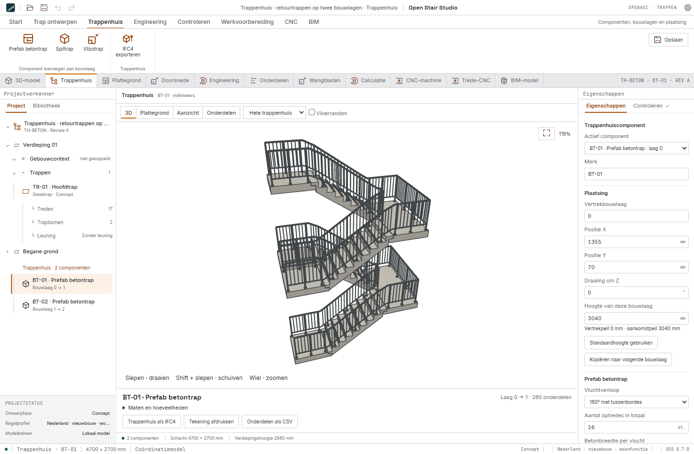

# Trappenhuis ontwerpen en coördineren

Open **Trap ontwerpen** en kies de familie bij **Traptype ontwerpen**. Via **Projectopstelling** kun je meerdere ontwerpen in een gebouw plaatsen. Plaats een prefab betontrap, spiltrap of vlizotrap. Elk merk heeft een vertrekbouwlaag, een positie in X en Y en een draaiing om de verticale as. De schachtoorsprong ligt linksonder in de plattegrond. Eén bestand kan verschillende componenten en verdiepingen bevatten. Met **Kopiëren naar volgende bouwlaag** blijven uitvoering, positie en draaiing behouden. De kopie krijgt een nieuw merk. Met **Hoogte van deze bouwlaag** geef je een verdieping een afwijkend hoogteverschil. Alle hogere peilen volgen daaruit.

## Van productdetail naar gebouwmodel

Met **Plaats voorbeeldtrappenhuis met twee bouwlagen** vul je een leeg trappenhuis in één keer met twee prefab retourtrappen. Het programma opent het samengestelde 3D-model. De voorbeeldpeilen zijn +0, +3.040 en +5.920 mm. Bewerk een bouwlaag of selecteer een van de prefab trappen om de aansluitingen te bekijken. Met Ongedaan maken haal je de opstelling weer uit het project.

| Ontwerpvraag | Onderzoeksbevinding en toepassing |
|---|---|
| Past de zoldertoegang ook tijdens het openen? | FAKRO onderscheidt de ruwbouwsparing, kastmaat, plafondhoogte, uitloop en benodigde ruimte bij ontvouwen. Het model bevat vier standen van dezelfde driedelige ladder. De kast en het opgevouwen pakket bepalen de benodigde inbouwruimte. Een aparte maat en streeplijn geven het ruimtebeslag tijdens het bedienen aan. [FAKRO maatprogramma](https://www.fakro.nl/producten/zoldertrappen/zoldertrap-op-maat/) · [Model, bronnen en maatdefinities](vlizotrap.md) |
| Aan welke kant komt een spiltrap boven? | Weland betrekt draairichting, aantal treden per omwenteling en bordesvorm bij het uitzetten van de trap. In het model schuiven de hulzen, treden, balusters en leuning mee als de steiging of draairichting verandert. De rechte aansluitrand van het bovenbordes en de omtrek van de ronde tredekrans hebben elk hun eigen maat. [Weland ontwerpgegevens](https://www.weland.com/en/products/staircases/spiral-staircases/planning-and-design/) · [Spiltrap en vrije draaihoogte](spiltrap.md) |
| Welke delen worden bij een betontrap daadwerkelijk ingehesen? | Vebo specificeert per type op-/aantrede, trapbreedte, plaatdikte en aansluitdetails. Schöck documenteert de overdracht tussen prefab vlucht en bordes via een tussenlaag. Hier worden de vluchten en bordessen als losse betonelementen gemodelleerd. De sponningen, oplegnokken en stelvoegen werken door in het volume per element. [Vebo productblad](https://productselector.vebo.nl/trappen-bordessen/trap-vlak/) · [Schöck oplegdetail](https://www.schoeck.com/en-gb/tronsole-f) · [Betonmodel en massabepaling](betontrap.md) |
| Wat moet in een coördinatiemodel herkenbaar blijven? | De Vries beschrijft de uitwisseling van trapmodellen met bouwpartners. In IFC4 krijgt ieder geplaatst component een eigen trapobject op de vertrekbouwlaag. Onderdelen hebben een materiaal, geometrie en eigen identiteit. Dezelfde onderdeelgeometrie levert het viewerbeeld, bovenaanzicht, vooraanzicht en de stukkenlijst. [De Vries Trappen, BIM](https://www.devriestrappen.nl/seriematige-trappen/bim/) · [buildingSMART, IfcStair](https://standards.buildingsmart.org/IFC/RELEASE/IFC4/ADD2_TC1/HTML/schema/ifcsharedbldgelements/lexical/ifcstair.htm) |

## Tekeningen en uitvoer

Kies **Actief component** voor een detail, **Vertrekbouwlaag** voor componenten op hetzelfde peil of **Hele trappenhuis** voor het samengestelde 3D-model en het gebouwaanzicht. De plattegrond vermeldt de getoonde bouwlaag. Bij afdrukken van het hele trappenhuis volgen na het gebouwaanzicht de tekeningen per vertrekbouwlaag. De CSV volgt de zichtbare selectie. **Geheel project als IFC4** exporteert alle geplaatste componenten met hun peilen. Met **Vloerranden** toon je de opgegeven schacht en vloerhoogten als referentie. Voor beoordeling van de aansluiting op echte vloeren, wanden en deuren gebruik je het bouwkundige gebouwmodel.

## Controle en gebruiksgrenzen

### Prefab werkvoorbereiding

In een leeg trappenhuis opent **Plaats prefabvoorbeeld met bijlegwapening en hijsplannen** een retourtrap met vijf afzonderlijke betonelementen. In **Prefabdetails → Elementhijsplan** kun je per vlucht of bordes het hijsgereedschap, de stationmaten en de productgegevens wijzigen. Bij een nieuw ontwerp activeer je de U-staven via **Bijlegwapening toevoegen**. Selecteer daar een oplegstrip, huls of kopbout om de plaatsing en de bijbehorende lokale toets te lezen. De PDF vermeldt het elementmerk op ieder blad. De instortstaat levert de exacte buigsegmenten en de IFC4-export koppelt iedere staaf aan het juiste betonelement en de voorziening. [Bewerkbaar voorbeeld](../examples/prefab-elementhijsplannen.oss.json) · [Werkplaatstekeningen en hijsplannen](../examples/prefab-elementhijsplannen.pdf) · [IFC4-model](../examples/prefab-elementhijsplannen.ifc)

Selecteer de betontrap en open **Prefabdetails → Wapening en instortdelen toevoegen**. Kies in **Prefabelement** de vlucht of het bordes. De elementassen vormen het nulpunt voor de hoofd- en verdeelstaven, hijshulzen, kopbouten, moeren en aansluitplaten. Op het werkplaatsblad staan de matten in bovenaanzicht en langsaanzicht. Doorsnede A–A toont de lagen in de dikte. De uitvergrote instortdetails laten de hulsvoet, het boutgat en de moer zien. De CSV bevat de werkelijke positie van ieder onderdeel. In 3D kun je het beton wegfilteren met **Alleen wapening en instortdelen**.

Voer in de eigenschappen onder **Belastingen**, **Betondoorsnede**, **Oplegging en verankering** en **Hijsen** de projectwaarden en documentreferenties in. Het tabblad **Berekening** geeft vraag, weerstand en uitkomst per fase. Bij onbekende hijsmassa of voorgemonteerde onderdelen blijft de hijsvraag open. Voor het kale element gebruikt het programma de ingestelde bulkdichtheid inclusief instortstaal. **Elementblad en berekening als PDF** drukt het geselecteerde prefab af. Vink **Alle elementen in de PDF** aan voor de complete trap. De IFC4-export koppelt de staven, instortdelen en uitkomsten aan het eigen betonelement. [Rekenmodel en bronnen](prefab-berekeningen.md) · [Voorbeeldproject](../examples/prefab-wapening.oss.json)

Bij een vlizotrap beoordeelt het model ook de ruimte die het luik en de ladder **tijdens het uitklappen** innemen. Deze zone draait met de luikkast mee en geldt in alle vier de standen. Een waarschuwing noemt het merk en het onderdeel dat mogelijk binnen dat bereik valt. Dit is een ruimtelijke voorselectie. De vrije werkruimte voor de persoon die de trap bedient vraagt een afzonderlijke beoordeling.

Een melding over overlappende onderdeelomhullenden verwijst naar de betrokken trapmerken en onderdelen. De ontwerper kan deze bekijken door **Hele trappenhuis** te kiezen. Leveranciersselectie en vrijgave voor productie vragen gegevens over onder meer materiaal, verbindingen, brandprestatie en bij beton de lokale bijlegwapening en de gedocumenteerde hijstoestand. De aanvullende toetsen voor glas, staalrooster en CLT in het dossier van de projecttrap hebben hun eigen toepassingsgebied. Voor de gebruiksfunctie en toepassing van de Nederlandse nieuwbouweisen is het aangewezen traptype bepalend. [IPLO, trappen bij nieuwbouw](https://iplo.nl/regelgeving/regels-voor-activiteiten/technische-bouwactiviteit/nieuwbouw/rijksregels/trappen/)
