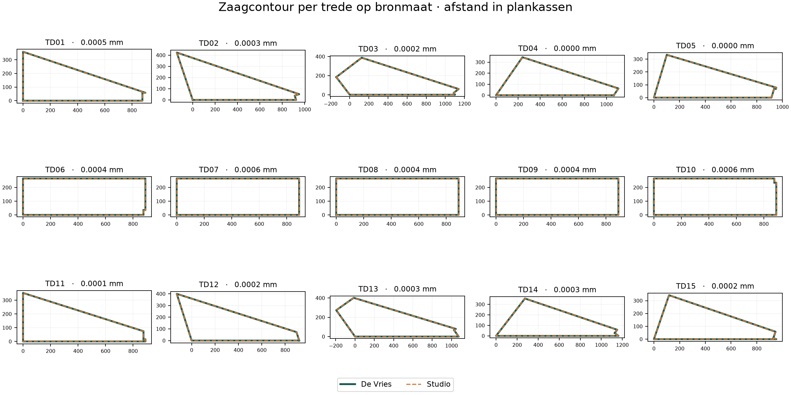

# Verdrijving per trede bij de dichte tweekwart

Trede 4 wijkt op de gemeten buitenmaat van 3140 × 992,105 mm minder dan 0,00005 mm af van de De Vries-contour. De eerdere spilvariant week hier 19,450 mm af. Over alle vijftien bladen blijft het grootste contourverschil op de bronmaat onder 0,0007 mm. Dit zijn numerieke modelvergelijkingen. De meetproef omvat geen fysieke trap of gefreesd proefstuk. [Eerdere spilmeting](spillen-tweekwart.md) · [Fabrikantmodel](https://www.devriestrappen.nl/friksbeheer/wp-content/uploads/2019/09/Tweekwart-Dicht-3160x1000-IFC.zip)

## Bediening en meetmethode

Kies bij de houten tweekwart **De Vries-voorbeeld toepassen** met de ontwerpmaat van 992 mm of de gemeten IFC-maat van 992,105 mm. Bij het onderkwart hoort de grensverschuiving bij de voorkant van de gekozen trede en bij het bovenkwart bij de achterkant. De verschuiving staat loodrecht op de stootbordlijn. Een verschoven gedeelde grens verandert daardoor ook het aangrenzende blad. De aansluitingen op het tussenstuk blijven op hun vaste positie.

De referentie bevat twee identieke IFC-bestanden met SHA-256 `71baad364be87316e989403eaf917e2ea8ca9db9685d7a03fc54db53cccef746`. De rechtertrap is vergeleken met de spiegeling van het linker fabrikantmodel. De meetproef sorteert de bladen op hoogte en projecteert de driehoeken van elk blad in het horizontale vlak. Hun vereniging geeft de volledige zaagcontour inclusief de uitsparingen voor de spillen. De afstand is de tweezijdige Hausdorff-afstand tussen de contourlijnen. Alle randen liggen in de berekening, ook de korte spilranden.

De projectassen registreren de twee trappen één keer op dezelfde buitenhoek en vertrekvloer. Voor de plankassen ligt het nulpunt steeds op het buitenste uiteinde van de werkelijke voorrand. De eerste as volgt die rand naar binnen. Dit tweede resultaat vergelijkt de vorm van elk zaagstuk onafhankelijk van de positie in de trap.

| Trede | Projectassen bij 992 mm | Projectassen bij 992,105 mm | Plankassen bij beide maten |
| --- | ---: | ---: | ---: |
| 1 | 0,1053 | 0,0005 | 0,0005 |
| 2 | 0,1051 | 0,0003 | 0,0003 |
| 3 | 0,1050 | 0,0002 | 0,0002 |
| **4** | **0,1050** | **< 0,00005** | **< 0,00005** |
| 5 | 0,1050 | < 0,00005 | < 0,00005 |
| 6 | 0,1050 | 0,0004 | 0,0004 |
| 7 | 0,1050 | 0,0004 | 0,0006 |
| 8 | 0,1050 | 0,0002 | 0,0004 |
| 9 | 0,1050 | 0,0006 | 0,0004 |
| 10 | 0,1050 | 0,0006 | 0,0006 |
| 11 | 0,1050 | 0,0001 | 0,0001 |
| 12 | 0,1050 | 0,0001 | 0,0002 |
| 13 | 0,1050 | 0,0002 | 0,0003 |
| 14 | 0,1051 | 0,0003 | 0,0003 |
| 15 | 0,1050 | 0,0002 | 0,0002 |

Waarden in millimeters, afgerond op vier decimalen, voor de linker IFC4. De fabrikantgeometrie is tot 0,001 mm vastgelegd. De extra cijfers maken de numerieke vergelijking reproduceerbaar.



## Trede 4 en de instelproef

De vier hoeken van het fabrikantblad liggen in stijgomloop op (78,105; 925,454), (78,105; 1000,148), (954,105; 737,376) en (954,105; 318,028) mm. De kant langs de onderspil meet 74,694 mm en de buitenkant meet 419,348 mm. In de aanvullende proef wordt de grens vóór TD4 met +5 mm verschoven. De opnieuw geopende IFC4 en IFCX geven 5,000 mm loodrechte verplaatsing van de voorrand. Alleen TD3 en TD4 veranderen. Hun grootste contourverplaatsing in de vaste assen is 6,085 mm, door de schuine aansluiting op de zijde van de trap.

## CNC en BIM

Het archief bevat voor elke combinatie van variant en draairichting één project, IFC4, IFCX en vijftien afzonderlijke LinuxCNC-programma’s met bijbehorende CAM-JSON. De drie varianten zijn de ontwerpmaat, de bronmaat en de lokale TD4-proef. De onafhankelijke controle leest de machine-XY-bewegingen en de dertien dieptegangen terug uit elk van de 90 programma’s. Via het planknulpunt en de opspanovermaat vergelijkt ze de nominale CNC-contour met de werkelijk geëxporteerde IFC-contour. De maximale toegestane afstand is 0,002 mm. Bij een Ø6 mm frees ligt de hartbaan langs iedere rand op 3 mm afstand van het randmidden. Inwendige spilhoeken krijgen een plaatselijke hoekontlasting. Het freesoppervlak is gecontroleerd op insnijding buiten deze ontlastingen. TD4 heeft vier uitwendige hoeken en krijgt geen ontlasting. De einddiepte is Z = −38,3 mm voor een blad van 38 mm. De twaalf spilverbindingen per trap doorstaan de digitale passingstoets. TD7–9 hebben geen spilaansluiting.

Alle zes IFC4-bestanden zijn met IfcOpenShell en de IFC4-EXPRESS-regels gevalideerd zonder meldingen. De zes IFCX-bestanden zijn rechtstreeks als JSON en driehoeksnetten teruggelezen. De meetproef controleert voor elk blad de wel van 45 mm, voor elke verdreven trede de twee grenswaarden en voor de trap de tien grensinstellingen, de draairichting en de verbindingen met beide spillen. De spiegelvergelijking omvat de 49 overige trapdelen en doorsneden van de twee spillen. De overeenkomstige hoekpunten van IFC4 en IFCX verschillen maximaal 0,000026 mm.

[Voorbeeldprojecten en machinebestanden](../examples/tweekwart-verdrijving.zip) · [Exportgenerator](../scripts/export-distributed-tweekwart.mjs) · [Onafhankelijke meetproef](../scripts/measure-distributed-tweekwart.py) · [Gemeten fabrikantcontouren](../scripts/testdata/devries-tweekwart-contours.json)

## Reproduceren

De standaardcontrole gebruikt de opgeslagen fabrikantcontouren en heeft het oorspronkelijke IFC-bestand niet nodig. Geef optioneel `--reference` mee om de bronhash en de vijftien opgeslagen contouren ook rechtstreeks tegen het fabrikantbestand te toetsen.

```powershell
node scripts/export-distributed-tweekwart.mjs "$env:TEMP/oss-astra-verdrijving"
uv run --no-project --python 3.12 --with ifcopenshell==0.9.0.post1 --with pytest --with matplotlib python scripts/measure-distributed-tweekwart.py "$env:TEMP/oss-astra-verdrijving" --express
uv run --no-project --python 3.12 --with ifcopenshell==0.9.0.post1 --with pytest --with matplotlib python scripts/measure-distributed-tweekwart.py "$env:TEMP/oss-astra-verdrijving" --reference "C:\BIM\Tweekwart-Dicht-3160x1000_L.ifc" --figure docs/vergelijking-tweekwart-verdrijving.png
```
